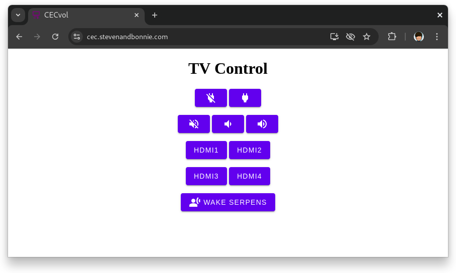

# CECVol

Control an LG webOS TV's volume, mute, power, inputs, playback, and navigation over LAN.



Includes a web remote UI, a WearOS watch app, and Google Home Cloud-to-Cloud Smart Home fulfillment (with a built-in stateless OAuth 2.0 server).

Originally built for a Raspberry Pi connected to an LG OLED-C9 over HDMI-CEC, it was later migrated to LG IP Control over LAN (keeping the `cecvol` name).

## How it works

- **LG IP Control:** Opens a TCP connection to port `9761` and sends AES-128-CBC encrypted text commands (`VOLUME_CONTROL`, `CURRENT_VOL`, `VOLUME_MUTE`, `MUTE_STATE`, `INPUT_SELECT`, `KEY_ACTION`, `POWER off`). Power-on uses Wake-on-LAN. Protocol ported from [WesSouza/lgtv-ip-control](https://github.com/WesSouza/lgtv-ip-control).
- **Web UI & WearOS:** Both call `/fulfillment` using Google Smart Home Action JSON payloads (`QUERY` / `EXECUTE`), assuming authentication is handled by a reverse proxy in front of the server.
- **Google Home Cloud-to-Cloud:** Exposes `/oauth/authorize` (expects an authenticated user header such as `Remote-Email` or `Remote-User` from a reverse proxy), `/oauth/token`, and `/google/fulfillment` (authenticated via HMAC-SHA256 Bearer tokens) supporting `SYNC`, `QUERY`, `EXECUTE`, and `DISCONNECT`.
- **Metrics:** Prometheus metrics at `/varz`.

## Build & Run

```bash
cargo build --release

# Run against an LG TV over LAN
cargo run -- \
  --lg-mac-addr "AA:BB:CC:DD:EE:FF" \
  --lg-keycode "MY_KEY" \
  --server-mac-addr "00:11:22:33:44:55"

# Run locally with an in-memory fake TV (no hardware needed)
cargo run -- --use-fake-tv --server-mac-addr "00:11:22:33:44:55"
```

### Enabling Google Home Cloud-to-Cloud

Set the OAuth flags (or corresponding environment variables) alongside the TV options:

```bash
OAUTH_CLIENT_SECRET="<32+ random bytes>" \
OAUTH_SIGNING_KEY="<separate 32+ random bytes>" \
cargo run -- \
  --lg-mac-addr "AA:BB:CC:DD:EE:FF" \
  --lg-keycode "MY_KEY" \
  --server-mac-addr "00:11:22:33:44:55" \
  --oauth-client-id "google-home-cecvol" \
  --google-project-id "your-google-home-project-id"
```

Expose `/oauth/authorize` behind your reverse proxy's auth middleware (forwarding `Remote-Email` or `Remote-User`), and allow unauthenticated public traffic to `/oauth/token` and `/google/fulfillment` (which verify client credentials and Bearer tokens directly).
